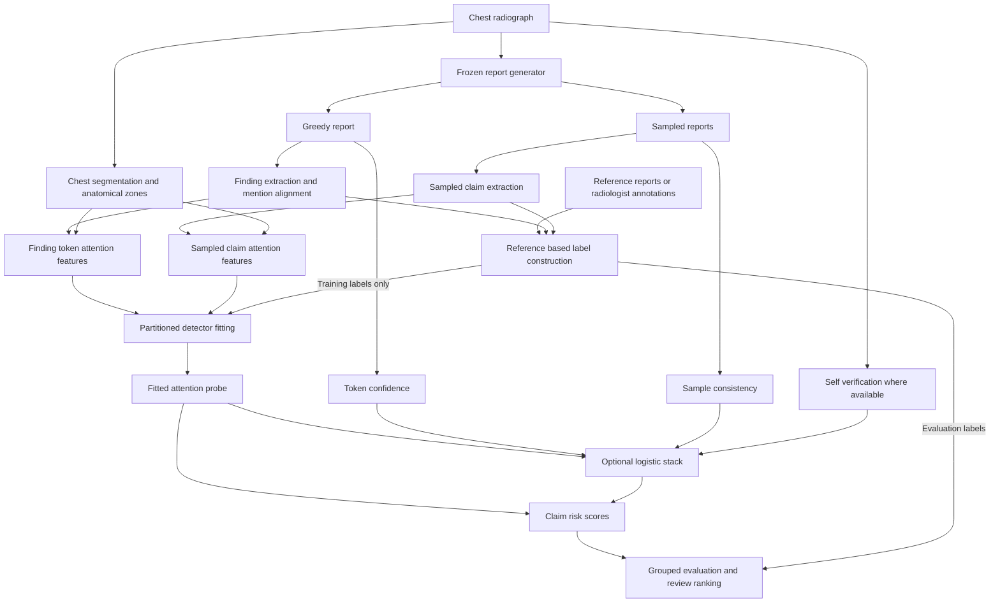
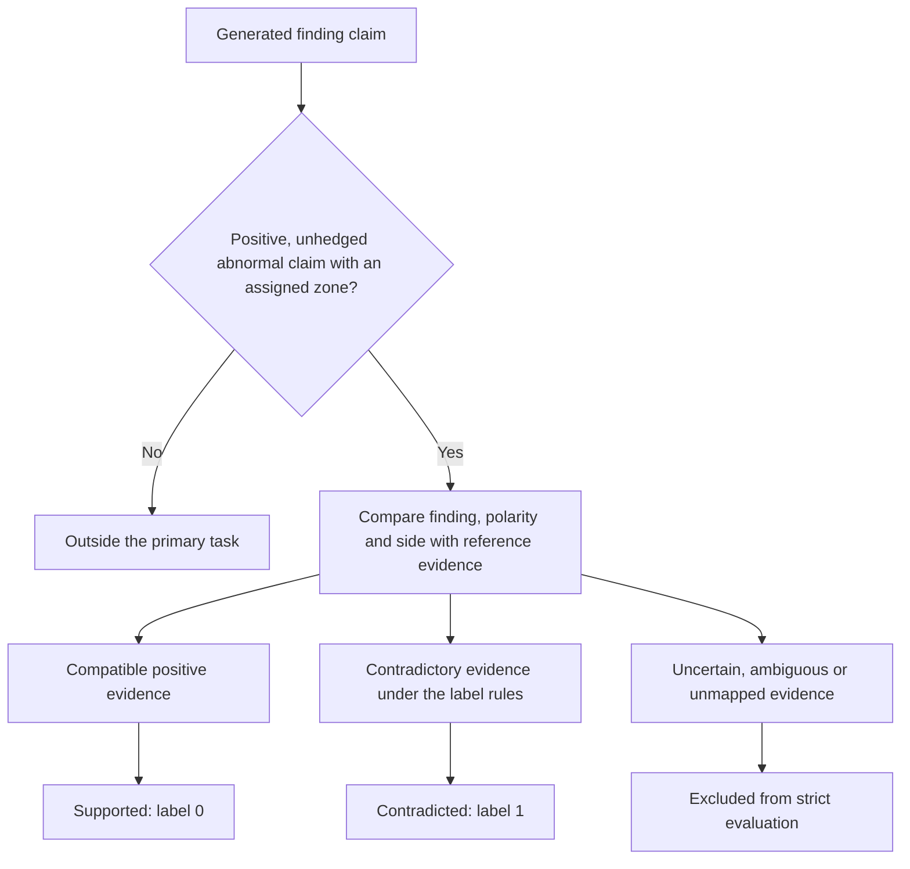
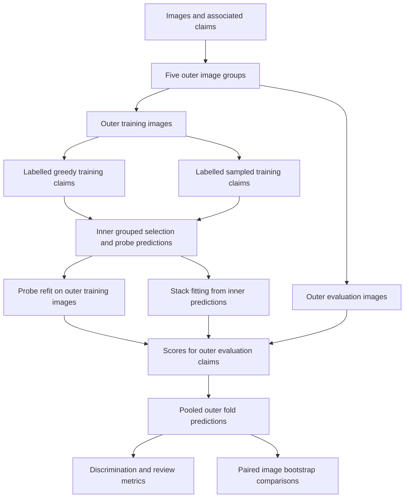

# VERA
### Visual Evidence Reliance Analysis

**Can Attention Reveal Unsupported Radiology Findings? VERA: Visual Evidence Reliance Analysis**

A research codebase for examining whether attention inside medical vision language models can identify generated radiology findings that disagree with reference evidence.

VERA connects finding extraction, token aligned attention analysis, reference based labeling, supervised probes and image grouped evaluation. Its output is a risk score for an individual asserted finding, rather than a single correctness score for an entire report.

---

## Project Overview

A generated chest radiograph report can read fluently while describing an abnormality that its reference evidence does not support. Language quality alone cannot establish whether the individual findings are supported.

VERA studies a complementary source of information: the attention recorded when a medical vision language model generates a finding mention.

The project represents each eligible claim using attention patterns across decoder layers and heads. A regularized linear probe learns whether those patterns predict reference disagreement. Additional configurations incorporate token confidence, consistency across sampled reports and model self verification.

The generators remain frozen. Learning takes place in the detectors fitted to the extracted representations.

The central distinction is between three questions:

1. **Prediction:** Does an attention signature help rank unsupported findings?
2. **Localization:** Do features associated with named anatomical regions add useful information?
3. **Explanation:** Does an attention map demonstrate that the generator causally relied on a particular region?

The experiments support predictive value in the evaluated settings. They provide more limited evidence for additional anatomical specificity and do not establish causal visual grounding.

## Research Questions

| Question | Evidence examined |
|---|---|
| Can attention distinguish supported and contradicted findings? | Claim level attention probes and comparison with text features |
| Does the signal extend beyond finding identity? | AUROC computed within individual finding types |
| Do sampled reports improve supervision? | Attention probes with and without sampled training claims |
| Does combining signals improve the detector? | Full stack compared with the sample augmented probe |
| Does anatomical assignment matter? | Matched named and shuffled zone controls |
| Is mention specific attention useful? | Claim attention compared with report averaged attention |
| What happens under a limited review budget? | Precision and recall at retrospective flag fractions |
| How sensitive are conclusions to reference conventions? | Strict and broad labels, parser checks and reference text audit |

## System Architecture

The code separates report generation, representation extraction, label construction, detector fitting and evaluation. Reference evidence supplies supervision and evaluation labels; it is not a detector input feature.

Two uses of sampled reports must be distinguished:

- **Training augmentation:** Additional labelled claims from training images expand the supervision available to the attention probe.
- **Inference time consistency:** Unlabelled sampled outputs from the assessed image provide consistency features for the full configuration.

Additional sampled claims do not constitute additional independent patients or images.

## Claim Representation and Evaluation Scope

The evaluated unit is an individual finding claim within a generated report.

A claim record can contain:

| Field | Meaning |
|---|---|
| Finding | Canonical abnormality identified by the parser |
| Mention span | Character offsets of the finding mention |
| Sentence | The generated sentence containing the claim |
| Polarity | Whether the finding is asserted or negated |
| Uncertainty | Whether the wording contains hedging |
| Laterality | Side information extracted from the text |
| Anatomical zones | Explicitly mapped or default assigned regions |
| Token alignment | Generated token positions associated with the mention |
| Image identifier | Source image used for grouping and traceability |

The parser recognizes **22 canonical finding types**.

Primary evaluation includes positive abnormality claims that:

- Are not negated.
- Are not marked as uncertain.
- Have at least one assigned anatomical zone.
- Have a usable label under the selected reference convention.

A default anatomical assignment does not mean that the generated sentence explicitly localized the finding.

This scope excludes report omissions and incorrect negative statements. Consequently, claim detection performance does not establish report completeness or verify every statement in an unflagged report.

## Reference Evidence and Label Construction

The operational target is agreement with the available reference evidence:

$$
Y(c;\rho)=
\begin{cases}
0, & \text{reference supported},\\
1, & \text{reference contradicted},\\
\bot, & \text{unresolved or ineligible}.
\end{cases}
$$

Here, \(c\) is a generated claim and \(\rho\) is its reference evidence.

### IU X ray references

IU labels combine report findings, impression text and available indexing tags.

The rules consider:

- Compatible finding mentions.
- Explicit negation.
- Laterality.
- Normal study tags.
- Applicable organ normality statements.
- Parent and child relationships between finding categories.
- Ambiguous related findings.

Two label definitions expose sensitivity to reference omissions:

| Definition | Otherwise unmentioned findings |
|---|---|
| **Strict** | Excluded unless an applicable contradiction rule provides evidence |
| **Broad** | Counted as errors |

Strict labeling narrows the evaluated population. Broad labeling changes both the assigned labels and the retained claim subset.

### VinDr CXR annotations

VinDr labels use the union of available reader annotations.

A compatible class and side can support a claim. Matching annotations confined to the opposite side can indicate a laterality error. An unmarked mapped finding is unsupported after ambiguity checks.

Some vocabulary mappings are approximate. For example:

- Pneumonia maps to **Consolidation**.
- Tortuous aorta maps to **Aortic enlargement**.
- Edema and fracture have no scored competition class in this protocol.

Strict and broad labels coincide for VinDr under the implemented annotation convention.

These labels remain reference based targets rather than independent clinical adjudications of every generated assertion.

## Attention Representation

VERA extracts attention associated with the tokens that express a finding.

For layer \(\ell\), head \(h\), finding token positions \(\mathcal T_c\) and image token positions \(\mathcal I\), the image attention share is:

$$
s_c^{\ell h}
=
\frac{1}{|\mathcal T_c|}
\sum_{t\in\mathcal T_c}
\sum_{i\in\mathcal I}
a_{ti}^{\ell h}.
$$

The representation combines five terms across decoder layers and attention heads:

| Term | Interpretation |
|---|---|
| Image share | Attention assigned to image tokens at the finding mention |
| Relative image share | Difference from the report average |
| Region attention | Normalized pooled attention within the assigned anatomical mask |
| Area normalized lift | Region attention relative to mask area |
| Region contrast | Difference between mention and report attention within the mask |

For \(L\) layers and \(H\) heads, the full signature has \(5LH\) dimensions.

| Generator | Layers | Heads per layer | Signature dimensions |
|---|---:|---:|---:|
| CheXagent | 32 | 32 | 5,120 |
| MAIRA 2 | 32 | 32 | 5,120 |
| MedGemma | 34 | 8 | 1,360 |

Spatial masks come from chest segmentation with an atlas fallback. The implementation accounts for differences in visual grids, image token positions and attention key lengths.

The signature measures attention allocation. Its predictive performance does not make each weight a causal explanation.

## Detector Components

### Attention probe

The primary learned representation is a regularized logistic probe over standardized attention features.

$$
p_c=\sigma(w^\top z_c+b).
$$

Here, \(z_c\) is the standardized signature and \(p_c\) is the probe output for reference contradiction.

Standardization and regularization selection occur within the fitting procedure. Evaluated images are excluded from supervised training.

### Sample augmented probe

This configuration adds eligible claims from sampled reports of training images.

The same image exclusion applies at inner validation and outer evaluation boundaries. Sampling expands the number of assertions available for training without increasing the number of independent images.

### Confidence

Confidence features summarize:

- Finding token log probabilities.
- Sentence and report log probabilities.
- Token entropy.
- Token margins.
- Confidence relative to the surrounding report.

### Sample consistency

Consistency features describe whether sampled reports:

- Assert the same finding.
- Negate the finding.
- Mention it in compatible anatomical zones.
- Contain no positive abnormal findings.

Missing information is represented explicitly.

### Self verification

Where supported, the generator is asked whether the image shows the canonical finding.

The representation includes the yes probability, the yes versus no logit difference and missingness. The verification question does not establish strict laterality entailment.

MAIRA 2 contributes no self verification feature in the reported configuration.

### Full logistic stack

The full configuration combines the probe output with the available additional signals:

$$
R_c=
\sigma\left(
\beta_0+
\beta_p\operatorname{logit}(p_c)+
\beta_C^\top C_c+
\beta_S^\top S_c+
\beta_Q^\top Q_c
\right).
$$

The verification term is omitted where unavailable.

The resulting score ranks claims by risk. It is not a prospectively calibrated probability of clinical error.

## Models and Datasets

### Recorded generator checkpoints

| Model | Checkpoint identifier |
|---|---|
| CheXagent | `StanfordAIMI/CheXagent-2-3b` |
| MAIRA 2 | `microsoft/maira-2` |
| MedGemma | `google/medgemma-4b-it` |

### Final generation configurations

| Setting | Maximum new tokens | Sampled reports |
|---|---:|---:|
| CheXagent | 256 | 3 |
| MAIRA 2 | 256 | 5 |
| MedGemma | 160 | 4 |

Sampling uses temperature **0.8** and top \(p\) **0.95**. The final MedGemma configuration also uses a repetition penalty of **1.05** and blocks repeated six token sequences.

These are the recorded final configurations. Historical notebooks and earlier defaults may describe different cohorts or sampling settings.

### Strict evaluation cohorts

| Setting | Processed images or studies | Images with eligible strict claims | Evaluated claims | Reference error prevalence |
|---|---:|---:|---:|---:|
| CheXagent / IU | 3,666 | 1,003 | 1,359 | 33.3% |
| CheXagent / VinDr* | 3,000 | 1,670 | 3,569 | 11.6% |
| MAIRA 2 / IU | 3,666 | 759 | 872 | 23.6% |
| MAIRA 2 / VinDr | 3,000 | 870 | 1,087 | 26.2% |
| MedGemma / IU | 3,000 | 548 | 723 | 24.6% |
| MedGemma / VinDr | 3,000 | 981 | 1,355 | 21.0% |

*CheXagent on VinDr predominantly produces detection lists.*

Eligible claim counts differ between generators. Aggregate error prevalence therefore does not compare their clinical accuracy on a shared statement set.

## Evaluation Design

### Primary protocol

The primary evaluation uses **five outer folds grouped by image**.

All claims from the same image remain together. Sampled claims from an evaluated image cannot enter supervised fitting.

Each model and dataset setting has a separately fitted detector. These experiments evaluate the procedure across settings; they do not transfer one trained detector directly between IU and VinDr.

Inner probe predictions serve both regularization selection and stack feature construction. Stack tuning does not introduce another fully independent probe refitting level for every internal split.

### Secondary protocol

A separate evaluation fits on a **40% calibration split** and scores the **60% test split**.

Primary grouped results and secondary held out results are reported separately.

### Metrics

| Metric | Question addressed |
|---|---|
| AUROC | How well are contradicted claims ranked above supported claims? |
| AUPRC | How does precision vary with error recovery under the observed prevalence? |
| Review precision | What fraction of flagged claims are labelled errors? |
| Review recall | What fraction of labelled errors enter the flagged set? |
| Within finding AUROC | Does discrimination remain when finding identity is held fixed? |
| Severity subgroup AUROC | How heterogeneous is performance under the fixed severity taxonomy? |

Within finding analysis requires at least eight claims of each label for a finding type. Its aggregate is weighted by claim count rather than balanced equally across the vocabulary.

### Uncertainty

Intervals and paired comparisons use **1,000 image bootstrap resamples**, retaining all associated claims for each sampled image.

These intervals condition on saved predictions. They do not include variability from retraining the detectors or reconstructing the references.

The paired one sided comparisons are exploratory and unadjusted for multiple testing.

## Results

### Primary strict label performance

| Setting | Text AUROC | Attention probe | Probe + samples | VERA full AUROC | VERA 95% interval | VERA AUPRC |
|---|---:|---:|---:|---:|---|---:|
| CheXagent / IU | 0.660 | 0.802 | 0.817 | 0.820 | [0.793, 0.843] | 0.687 |
| CheXagent / VinDr* | 0.608 | 0.837 | 0.860 | 0.857 | [0.836, 0.877] | 0.496 |
| MAIRA 2 / IU | 0.650 | 0.726 | 0.770 | 0.790 | [0.755, 0.825] | 0.559 |
| MAIRA 2 / VinDr | 0.796 | 0.840 | 0.860 | 0.865 | [0.842, 0.888] | 0.713 |
| MedGemma / IU | 0.663 | 0.720 | 0.738 | 0.745 | [0.703, 0.788] | 0.492 |
| MedGemma / VinDr | 0.682 | 0.774 | 0.809 | 0.814 | [0.783, 0.842] | 0.560 |

The full configuration reaches **0.745 to 0.865 AUROC**, with gains of **0.070 to 0.249** over the specified text baseline.

Within finding AUROCs remain between **0.706 and 0.851**, supporting predictive information beyond finding identity alone.

### Retrospective review at a 20% flag rate

| Setting | Precision | Recall |
|---|---:|---:|
| CheXagent / IU | 0.735 | 0.442 |
| MAIRA 2 / VinDr | 0.716 | 0.547 |
| MedGemma / VinDr | 0.542 | 0.516 |

The flagged queues concentrate errors, but substantial numbers remain outside review. These are retrospective operating points rather than validated clinical thresholds.

## Component Analysis

The component results distinguish the most strongly supported contributions from the more tentative ones.

| Comparison | Main observation |
|---|---|
| Attention versus text | The unaugmented attention probe exceeds text in every primary setting |
| Sample augmentation | Improves the probe in all six settings |
| Full stack versus augmented probe | No significant primary improvement in any setting |
| Claim attention versus report average | Improvement in five primary settings |
| Named versus shuffled regions | Small effects with limited additional anatomical evidence |
| Simple low image attention | Insufficient to explain the trained probe's performance |

On CheXagent IU, a low image share score alone reaches approximately **0.571 AUROC**, compared with **0.802** for the trained attention probe. The useful signal is therefore more structured than a universal low attention threshold.

The evidence supports the attention representation and additional sampled training claims more clearly than a necessary benefit from every component of the full stack.

### Label sensitivity

Under broad IU labels, VERA reaches:

- **0.799** for CheXagent.
- **0.790** for MAIRA 2.
- **0.742** for MedGemma.

These comparisons change both labeling and claim inclusion. They do not isolate label quality as a single causal factor.

## Visual Evidence

The project includes complementary visual analyses:

| Visual family | Purpose |
|---|---|
| Overall discrimination | Compare VERA with text features across settings |
| Finding conditioned discrimination | Examine performance beyond finding identity |
| Paired ablations | Separate component contributions |
| ROC curves | Inspect ranking across thresholds |
| Precision recall curves | Relate error recovery to prevalence |
| Review budget curves | Show precision and recall under queue size constraints |
| Cohort composition | Distinguish evaluated claims, exclusions and sampled rows |
| Severity intervals | Expose weaknesses hidden by aggregate scores |
| Learning and layer profiles | Explore supervision budget and attention heterogeneity |
| Individual finding results | Identify variation across abnormality types |
| Radiograph and attention examples | Illustrate inputs, generated claims and anatomical assignments |

Attention overlays retain an illustrative role. An anatomical outline is an assigned zone, not a clinician annotated lesion boundary.

The supplied examples include reference supported findings, a finding absent from the reference and a reference negated finding. These statuses must not be collapsed into a single category of independently verified clinical error.

## Codebase Organization

The implementation is organized around the `vera` package.

| Component | Responsibility |
|---|---|
| `data.py` | Dataset handling, cohort selection and image manifests |
| `model.py` | Generator loading and model specific adapters |
| `text.py` | Sentence boundaries, finding extraction, polarity, uncertainty and locations |
| `labels.py` | Reference indexing, strict labels and VinDr mappings |
| `anatomy.py` | Anatomical masks, segmentation based zones and atlas fallback |
| `segment.py` | Segmentation artifact generation |
| `extract.py` | Generation, token alignment, attention extraction, sampling and verification signals |
| `v6.py` | Primary claim construction, feature families and grouped detector evaluation |
| `probes.py` | Probe utilities, feature construction and versioned comparisons |
| `analysis.py` | Metrics, bootstrap utilities and earlier analysis components |
| `verifier.py` | Selected external chest classifier baselines |
| `review.py` | Review sheets, separate answer keys and illustrative overlays |
| `pipeline.py` | Coordination of data, extraction, segmentation, analysis and result artifacts |
| `setup_env.py` | Model environment compatibility logic |
| `build_notebook.py` | Notebook generation from the project components |

Versioned analysis files preserve the development history. Their names do not imply that every historical result or default belongs to the final evaluation.

The final reported numbers correspond to the recorded final configurations and score artifacts.

## Research Artifacts

The project distinguishes artifacts produced by the pipeline from artifacts available in the supplied research package.

### Artifact roles

| Artifact | Information represented |
|---|---|
| Image manifests | Image identity, reference fields and split assignments |
| Extraction JSON | Generated reports, claims, token spans, samples and model diagnostics |
| Attention NPZ | Numerical attention representations and token statistics |
| Segmentation artifacts | Zone masks and segmentation validity |
| Prediction CSV | Claim identifiers, labels and detector scores |
| Result JSON | Candidate metrics, intervals and comparisons |
| Summary Markdown | Human readable experiment summaries |
| Review sheets | Generated claims and fields for independent review |
| Separate review keys | Reference labels, reasons and risk scores |
| Figures | Quantitative summaries and illustrative examples |

Saved prediction columns identify the label definition, evaluation protocol and detector candidate. This supports tracing reported metrics back to the corresponding scores.

### Availability boundaries

The supplied materials include code, score files for the six final settings, result summaries and selected visual examples.

They do not include every original radiograph, all extracted attention arrays, complete manifests or model weights.

Accordingly:

- Saved scores support metric recomputation.
- Full detector retraining requires the extracted features and associated records.
- Repeating generation requires the upstream datasets, model checkpoints and compatible environments.
- Upstream datasets and model weights remain governed by their respective access terms.

## Validation and Audit Coverage

### Artifact consistency

During manuscript preparation, **280 available candidate AUROCs** were recomputed from the six score files across the saved label sets and evaluation protocols.

The recomputed values agreed with the recorded summaries within three decimal rounding.

This checks consistency between supplied scores and summaries. It does not reproduce the original generator experiments.

### Reference text audit

A nonclinical audit of **100 strict IU claims** recorded:

| Outcome | Count |
|---|---:|
| Agreement with assigned label | 92 |
| Ambiguous | 3 |
| Label error | 5 |

The audit compares rule assigned labels with reference text. It does not independently assess the radiographs or measure disease omitted by a reference report.

### Test coverage represented in the codebase

The test suite includes:

- Negation and reference labeling cases.
- Manifest construction checks.
- Mock extraction checks.
- MAIRA 2 and MedGemma adapter checks.
- Synthetic signal and control experiments.
- Version specific regression checks.

Synthetic and mock tests examine implementation behavior. They do not establish clinical validity.

### Historical corrections

Earlier experiments exposed problems involving visual grids, mention offsets, image grouping and negation scope.

One important parser correction preserved negation through coordinated lists such as:

> No consolidation, effusion or pneumothorax.

Historical comparisons mix changes in labels, features and training data. Those comparisons cannot isolate the effect of a single correction.

Earlier masking and extraction experiments remain part of the audit trail rather than primary evidence for the final method.

## Limitations and Interpretation

### Reference disagreement is not independent diagnosis

The target depends on reference conventions, annotation coverage, laterality rules and vocabulary mappings. An assertion can be absent from a report without being clinically false.

### Attention prediction is not causal explanation

Predictive attention patterns do not prove that a highlighted region caused the generated claim. Anatomical controls provide limited additional evidence for region specificity.

### Generalization remains bounded

Each setting has its own fitted detector. Cross dataset detector transfer, prompt transfer and prospective institutional transfer are not established.

Possible generator training overlap remains unresolved. CheXagent's detection list behavior on VinDr is an additional qualification.

### Statistical uncertainty is conditional

Bootstrap intervals omit detector training randomness and uncertainty in reference construction. Small effects under multiple unadjusted comparisons require cautious interpretation.

### Operational benefit remains unmeasured

The study does not establish probability calibration, prospective reader benefit or improved clinical decisions.

Attention extraction, anatomical processing, repeated generation and verification can impose different costs. Feature dimensionality alone cannot establish a speed advantage.

### Reproducibility has distinct levels

Agreement between saved scores and summaries supports artifact consistency. Independent retraining and repetition of generation require additional upstream artifacts.

### Overall conclusion

VERA provides evidence that attention signatures can help prioritize potentially unsupported positive findings in generated radiology reports.

The clearest gains come from the learned attention representation and sampled training claims. The full stack is not uniformly superior to the simpler augmented probe, and the results do not establish clinical readiness.

## Associated Manuscript

**Can Attention Reveal Unsupported Radiology Findings? VERA: Visual Evidence Reliance Analysis**

**Authors:** Utkarsh Singh, Kartik Tiwari, Kshitij Dahiya and Sachin Gupta

**Institution:** Maharaja Agrasen Institute of Technology, New Delhi, India
